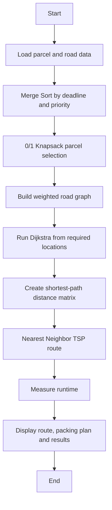

# Phase 1 — Courier Problem Design and Planning

## Objective
Given parcels, a vehicle capacity, a depot, delivery locations, and road distances, choose a high-priority feasible parcel set and construct an approximate delivery tour.

## Input model

### Parcel
Each parcel has:
- `id`: unique parcel identifier
- `destination`: graph vertex where it must be delivered
- `weight`: capacity consumed
- `deadline`: smaller values mean earlier deadlines
- `priority`: numerical benefit used by the knapsack objective

### Road network
The road network is an undirected weighted graph:
- Vertex: depot or delivery location
- Edge: road between two locations
- Edge weight: non-negative distance in kilometres

## Algorithm pipeline

1. Load parcel and road-network data from JSON files.
2. Sort parcels by ascending deadline; break ties using descending priority.
3. Run 0/1 Knapsack to maximize total selected priority without exceeding vehicle capacity.
4. Collect the unique destinations of selected parcels.
5. Run Dijkstra from the depot and each selected destination.
6. Build a shortest-path distance matrix for the required locations.
7. Apply Nearest Neighbor TSP to select the next closest unvisited destination.
8. Return to the depot and report the approximate tour length.
9. Measure runtime for major algorithmic components on multiple input sizes.

## Flow diagram

## Design assumptions and scope
- Each parcel is either selected once or not selected.
- The vehicle has one fixed capacity for the trip.
- The objective of Knapsack is maximum sum of priority scores.
- Deadlines determine sorting order; the prototype does not model travel-time windows or guarantee on-time arrival.
- Road edges are undirected and have non-negative weights.
- Selected parcels sharing a destination are delivered at the same stop.
- The route starts and ends at the depot.
- Nearest Neighbor is a heuristic and does not guarantee an optimal TSP tour.
